# Enterprise IT Infrastructure Lab

**Oracle Cloud Infrastructure · Windows Server 2022 · Active Directory · Ubuntu Server · GLPI**

A simulated corporate IT environment built to practise Windows and Linux administration, directory services, file access control, cloud networking and IT service management.

## Environment

| Component | Role | Result |
|---|---|---|
| Oracle Cloud Infrastructure | Hosts the Windows and Linux virtual machines and network controls | Deployed; screenshots document the configuration at the time of testing |
| Windows Server 2022 Standard (`DC01`) | Active Directory Domain Services and DNS for `corp.lab` | Domain and departmental structure configured |
| Active Directory | Five departmental OUs, users and security groups | 19 demonstration accounts across IT, HR, Marketing, Management and Finance |
| Windows file services | Departmental folders, SMB shares and ACL configuration | Share inventory and one folder ACL are documented; effective-access testing remains incomplete |
| Ubuntu Server | GLPI application host | Apache2, PHP, MariaDB and GLPI deployed |
| GLPI LDAP integration | Connects GLPI to Active Directory | One captured test passed TCP connection, LDAP URI, bind and search checks; 23 entries returned |
| GLPI service desk | User import, authentication and ticket workflows | Screenshots show user records, a group association, ticket handling and an offboarding example |

## Architecture

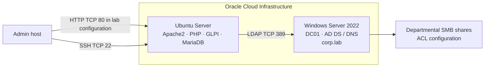

The diagram shows the main systems and documented communication paths. One captured GLPI LDAP test records a successful connection to `dc01.corp.lab` on TCP 389, with a search returning 23 entries; it does not establish current service availability. HTTP/80 and LDAP/389 describe the lab configuration at capture time, not recommended defaults for a publicly accessible production deployment.

## Evidence

### Active Directory structure

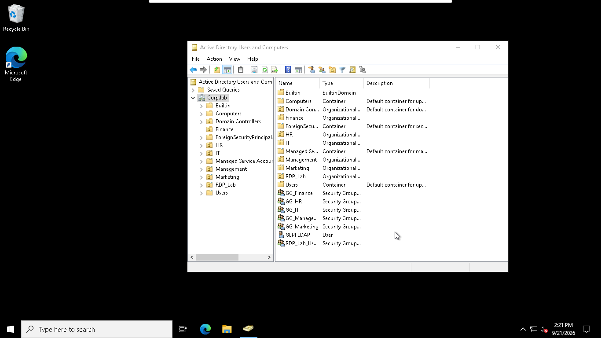

This view shows the `corp.lab` directory structure at capture time.

### SMB share inventory

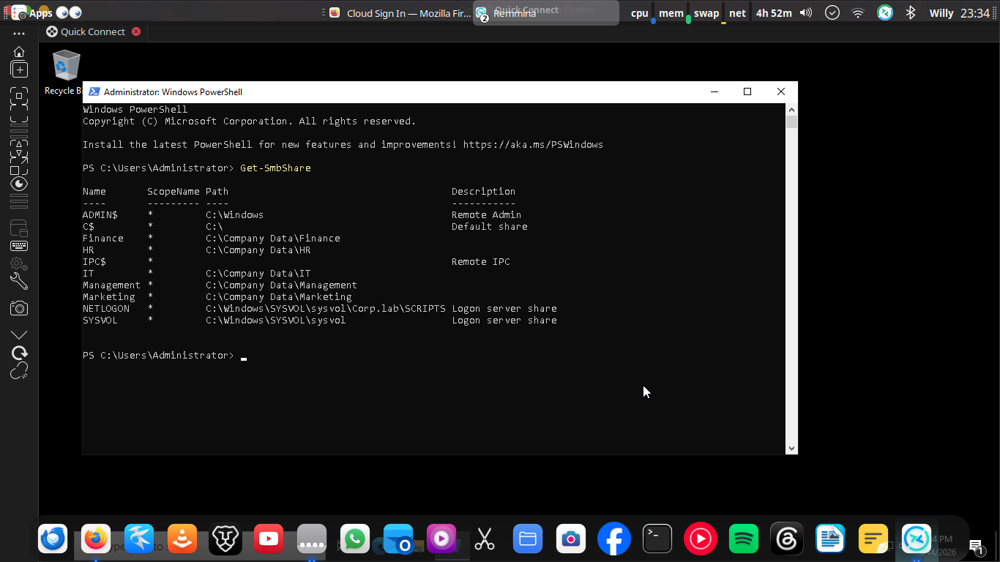

The output lists share names and paths. It does not show effective permissions for any user.

### Folder permissions

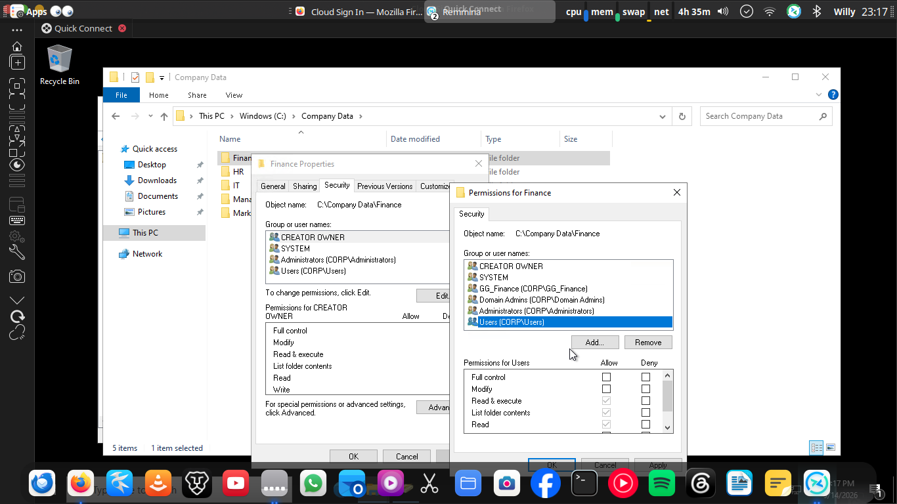

This Finance ACL view includes `GG_Finance` and a `CORP\Users` read-type entry. It records configuration only; it does not establish every user's effective access, and the intended scope of the broader entry is not established by this capture.

### OCI network security configuration

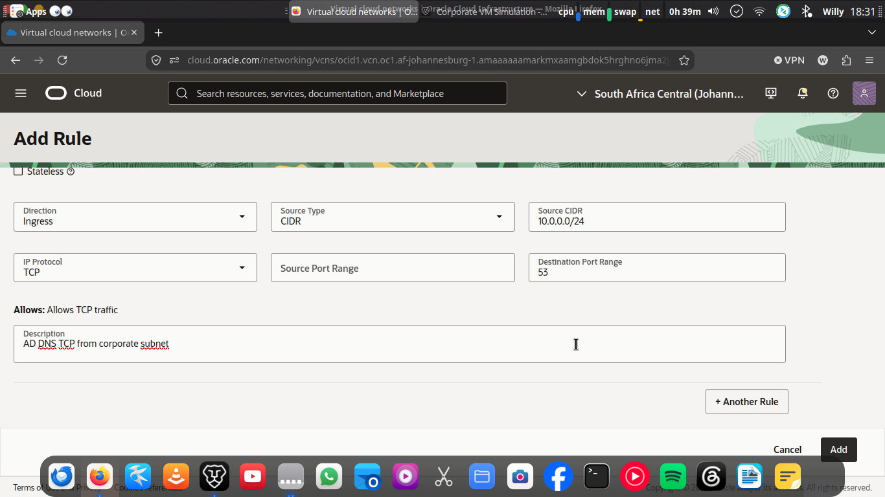

This is one rule-configuration view showing TCP 53 from `10.0.0.0/24`; it is not a complete or current security-rule inventory.

### GLPI LDAP integration

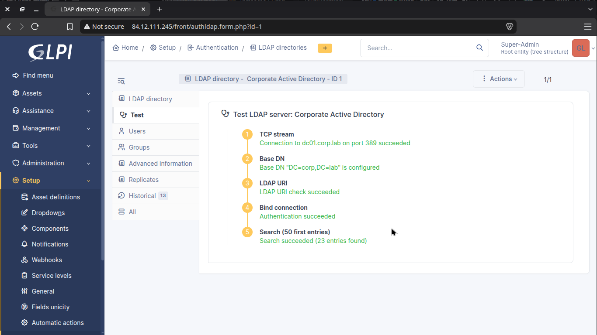

The captured test shows TCP connectivity, Base DN configuration (`DC=corp,DC=lab`), LDAP URI validation, bind authentication and a search returning 23 entries. It records that test only, not current service availability.

### Imported directory users

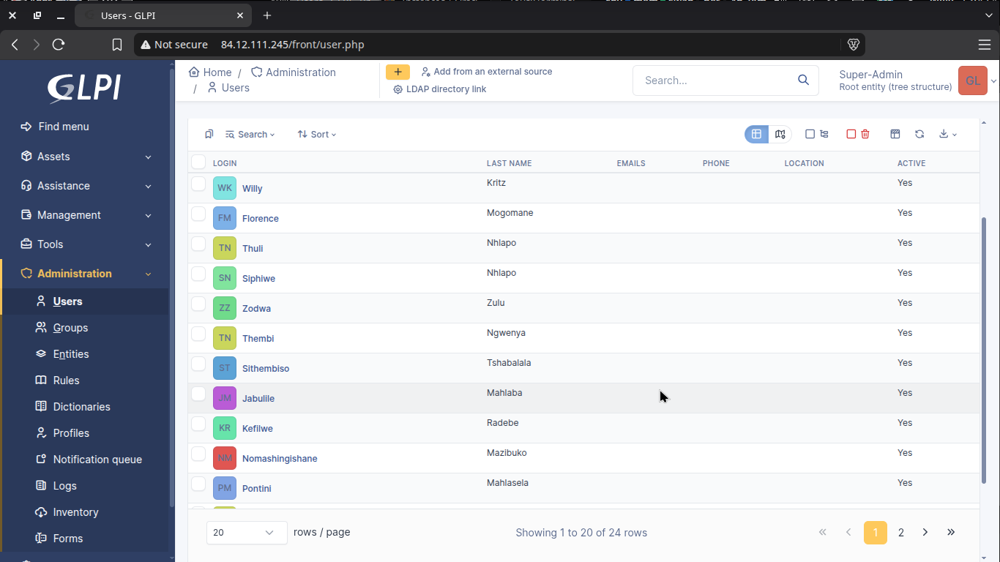

The GLPI list shows user records at capture time; it does not prove every listed account came from the captured LDAP search.

### Directory synchronization

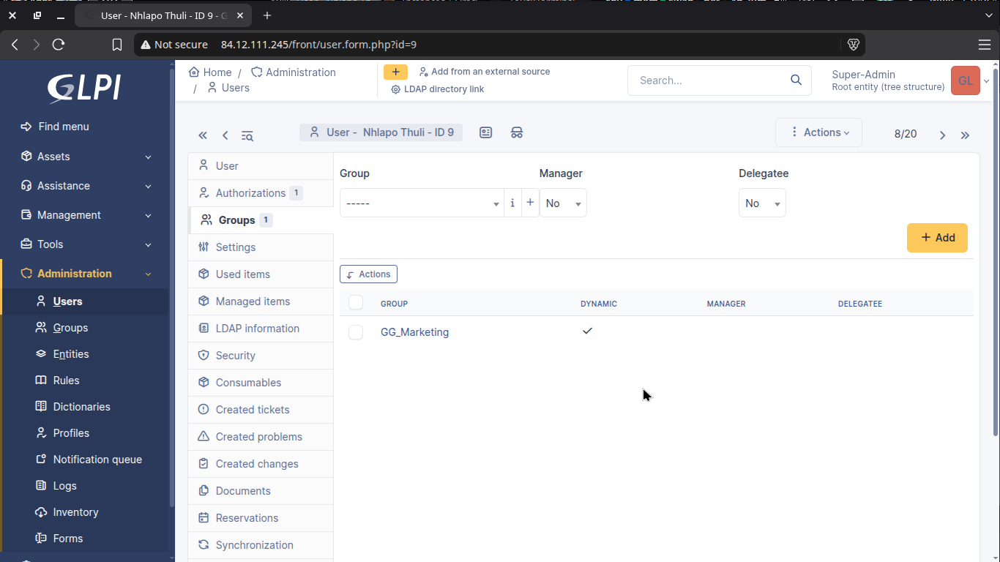

This user view shows a `GG_Marketing` group association. It is an example of directory-related user state, not proof of continuous or fully automated synchronization.

### Ticket handling

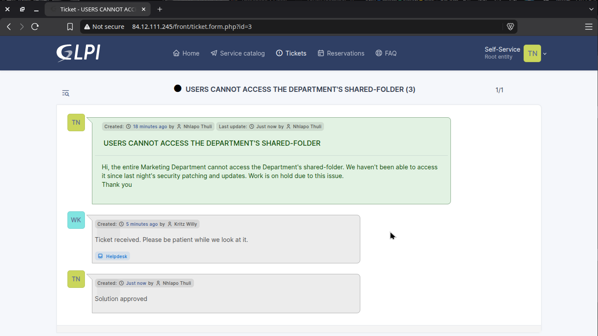

This is one ticket conversation about shared-folder access, with a helpdesk response and a user approval. It does not prove the access issue was independently retested or that all ticket workflows are automated.

### Active Directory account disablement

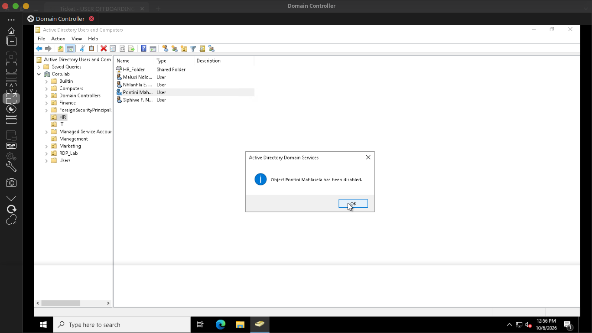

The confirmation dialog records one account being disabled; it does not prove all sessions or downstream access were revoked.

### GLPI offboarding

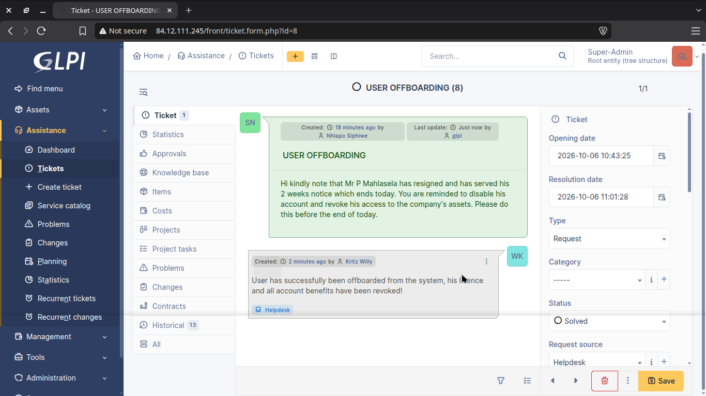

This is one GLPI offboarding ticket marked solved, not evidence that every offboarding action is automated or independently verified.

The [evidence index](docs/evidence-index.md) summarizes the ten screenshots included here. The PNG files preserve the original archive bytes. Several GLPI captures show a historical server IP and account names; the screenshots do not establish whether the address is still active.

## Work demonstrated

- Windows Server 2022 administration and Active Directory configuration.
- Departmental OU, user and security-group management.
- SMB share administration and folder ACL configuration; effective access testing remains incomplete.
- Linux server administration and deployment of Apache2, PHP, MariaDB and GLPI.
- LDAP connection testing, bind authentication and directory search.
- GLPI directory user records and group association, plus example ticket and offboarding workflows.
- Troubleshooting SSH access, cloud security rules, hostname resolution and directory synchronization.

## Current status and limitations

- **RDP:** Domain-user desktop sessions are working as of 14 October 2026. The earlier blank/loading-session problem is resolved.
- **File permissions:** Share and ACL configuration is documented. The available evidence conflicts on the Finance user's effective access, and complete allow/deny tests for all departments are not recorded.
- **Windows client domain join:** Not verified in the current evidence set.
- **WireGuard:** The configured tunnel is documented in [networking and WireGuard](docs/networking-and-wireguard.md), but its current peer handshake and routes are not evidenced in this repository.
- **Cloud status:** Screenshots capture the environment during testing; they do not indicate whether the OCI instances are currently running.

## Documentation

- [Architecture](docs/architecture.md)
- [Active Directory design](docs/active-directory-design.md)
- [File services and access control](docs/file-services-and-access-control.md)
- [Ubuntu, GLPI and LDAP](docs/ubuntu-glpi-ldap.md)
- [Networking and WireGuard](docs/networking-and-wireguard.md)
- [Troubleshooting log](docs/troubleshooting-log.md)
- [Implementation status](docs/implementation-status.md)
- [Phase 1 report](docs/phase-1-implementation-report.md)
- [Verification review](docs/phase-1-verification-review.md)
- [Validation matrix](docs/validation-matrix.md)
- [Evidence index](docs/evidence-index.md)
- [Security considerations](docs/security-considerations.md)
- [Windows domain-join troubleshooting runbook](docs/runbooks/domain-join-troubleshooting.md)
- [PowerShell scripts](scripts/)

## Security considerations

This is a learning lab, not a production reference architecture. The documented GLPI path uses HTTP and the LDAP test uses TCP 389. For an environment exposed beyond an isolated lab, use HTTPS and LDAPS or StartTLS with certificate validation, restrict network rules to required sources, and use least-privilege service identities. Keep Active Directory, SMB and RDP services on private networks or an appropriately controlled VPN.
