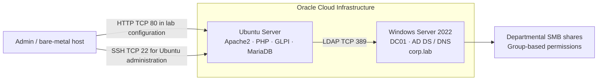

# Enterprise IT Infrastructure Lab

**Phase 1 — Infrastructure, Active Directory, File Services & GLPI Integration**

A hands-on simulated corporate IT environment deployed in Oracle Cloud Infrastructure (OCI), using Windows Server 2022 Standard as the Active Directory domain controller and Ubuntu Server for the GLPI service-management stack.

> **Portfolio status:** The core lab was reported operational in the attached implementation report, and the attached screenshots provide evidence of AD structure, file services, a successful GLPI LDAP test, directory imports, tickets, and offboarding workflows. The verification record is not uniformly complete: some folder-access tests remain untested or inconsistent, and individual-user RDP sessions remain a known issue. See [the verification review](docs/phase-1-verification-review.md).

## Overview

The purpose of this lab is to practise and demonstrate Windows Server administration, Active Directory identity lifecycle operations, departmental file access, Linux web-service administration, LDAP integration, and IT service management.

### Main components

| Component | Role | Evidence / status |
|---|---|---|
| Oracle Cloud Infrastructure | Hosts lab virtual machines and network controls | Deployment and security-rule evidence supplied |
| Windows Server 2022 Standard (`DC01`) | Active Directory Domain Services for `corp.lab` | Domain and departmental OU evidence supplied |
| Active Directory | Departmental OUs, users and security groups | Directory structure and group-membership screenshots supplied |
| Windows file services | Company/departmental folders, SMB shares and group-based permissions | Share, ACL and mapping screenshots supplied; full positive/negative access matrix is incomplete |
| Ubuntu Server | Hosts the GLPI application stack | Service status and troubleshooting described in the implementation notes |
| Apache2, PHP, MariaDB, GLPI | Web-based IT service-management platform | Dashboard, tickets, user sync and offboarding evidence supplied |
| LDAP / TCP 389 | GLPI-to-Active Directory integration | Screenshot shows connection, bind and search succeeded; 23 entries found |

## Architecture

This is a simplified Phase 1 view from the supplied report. It does not imply that every route or endpoint has been independently retested today. The captured GLPI screen shows a successful LDAP test to `dc01.corp.lab` on TCP 389. HTTP on TCP 80 and LDAP on TCP 389 are shown as the lab's documented configuration, not as production security recommendations.

## Evidence highlights

### Active Directory structure

### Shared-folder administration

### GLPI LDAP test

The supplied screenshot reports that the TCP stream to `dc01.corp.lab:389` succeeded, the base DN `DC=corp,DC=lab` was configured, LDAP URI checking succeeded, bind authentication succeeded, and a search returned 23 entries. The public network address in the browser bar has been redacted.

### Imported directory users and service-desk workflow

### Account lifecycle / offboarding

The [evidence index](docs/evidence-index.md) maps all supplied screenshots to their intended use. Images have been renamed and browser URLs containing a public IP / cloud resource identifier have been redacted.

## What this demonstrates

- Deploying and administering Windows Server 2022 as a domain controller.
- Organising domain users within five departments: IT, HR, Marketing, Management and Finance.
- Using departmental security groups as the basis for shared-folder permissions.
- Administering SMB shares and mapped drive access.
- Deploying a Linux-hosted web application stack with Apache2, PHP, MariaDB and GLPI.
- Testing GLPI-to-Active Directory LDAP connectivity, bind authentication and directory search.
- Importing directory users, synchronising records, and documenting ticket and offboarding workflows.
- Troubleshooting SSH file permissions, network-security rules, browser HTTP/HTTPS behaviour, LDAP name resolution and group mapping.

## Known gaps and limitations

- **RDP:** domain-user authentication was reported to reach a blank/loading session. This remains unresolved and is explicitly documented as a known issue.
- **Share access:** the evidence includes a Finance access-denied scenario. The attached report's verification tables are inconsistent about the Finance test and mark several other positive/negative tests as not tested. A complete per-department access matrix is still required.
- **Verification record:** the source report gives an overall Phase 1 PASS but also has placeholder/NOT TESTED rows. This repository preserves the successful test evidence while treating incomplete rows as incomplete rather than claiming comprehensive sign-off.
- **Windows client domain join:** a successful domain join is not established by the attached Phase 1 report/screenshots and is not claimed here.
- **Transport security:** the documented GLPI web path uses HTTP/80 and LDAP/389. Limit access to the intended lab networks; production use requires a secure design, TLS/certificate validation, least-privilege access and appropriate network restrictions.
- **Current cloud state:** screenshots are historical evidence. They do not prove that OCI resources are still running now.

## Repository guide

- [Architecture](docs/architecture.md)
- [Phase 1 implementation report](docs/phase-1-implementation-report.md)
- [Active Directory design](docs/active-directory-design.md)
- [File services and access control](docs/file-services-and-access-control.md)
- [Ubuntu / GLPI / LDAP](docs/ubuntu-glpi-ldap.md)
- [Networking and security rules](docs/networking-and-wireguard.md)
- [Troubleshooting log](docs/troubleshooting-log.md)
- [Verification review](docs/phase-1-verification-review.md)
- [Validation matrix](docs/validation-matrix.md)
- [Evidence index](docs/evidence-index.md)
- [Publication and security checklist](docs/security-and-publication.md)
- [Domain join troubleshooting runbook](docs/runbooks/domain-join-troubleshooting.md)
- [PowerShell scripts](scripts/)
- [Sanitized screenshots](screenshots/)

## Publishing to GitHub

This bundle includes [`publish-to-github.sh`](publish-to-github.sh) for the owner to run locally using their configured SSH identity. See [PUBLISHING.md](PUBLISHING.md). The script refuses to overwrite a non-empty remote repository.

## Safety note

This is an educational lab, not a production reference architecture. Do not commit real passwords, private keys, OCI auth files, database dumps, LDAP bind secrets, session cookies or unredacted public network endpoints. Review the security checklist before making changes public.
