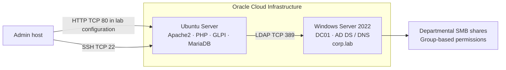
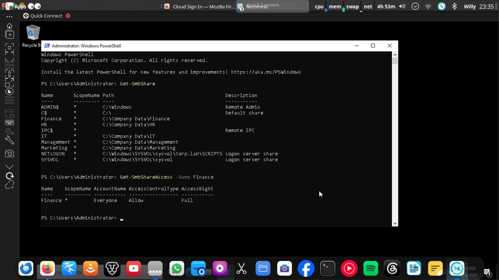
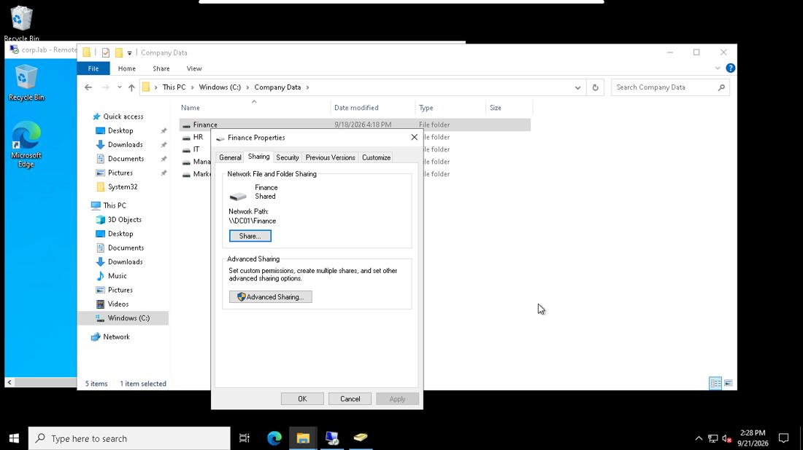
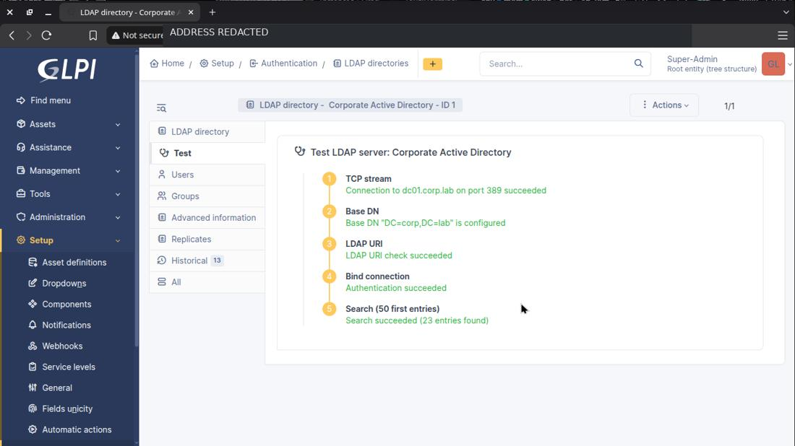
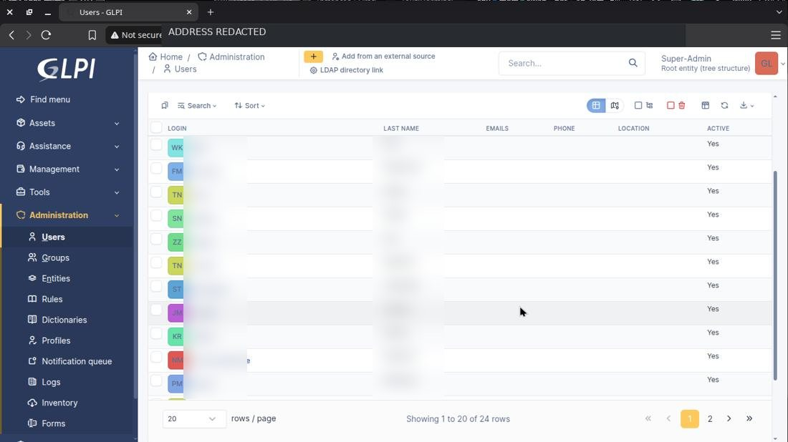
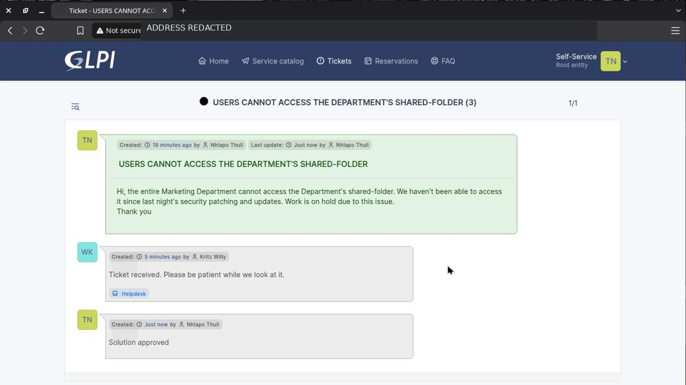
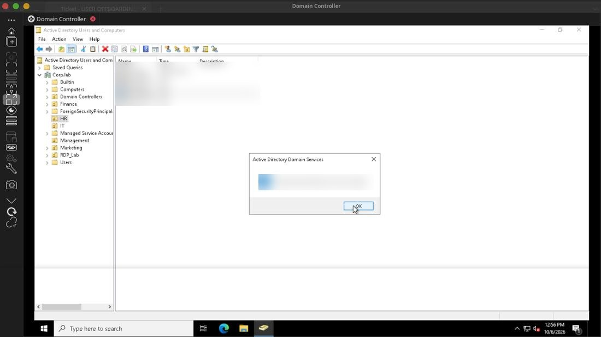

# Enterprise IT Infrastructure Lab

**Oracle Cloud Infrastructure · Windows Server 2022 · Active Directory · Ubuntu Server · GLPI**

A simulated corporate IT environment built to practise Windows and Linux administration, directory services, file access control, cloud networking and IT service management.

## Environment

| Component | Role | Result |
|---|---|---|
| Oracle Cloud Infrastructure | Hosts the Windows and Linux virtual machines and network controls | Deployed; screenshots document the configuration at the time of testing |
| Windows Server 2022 Standard (`DC01`) | Active Directory Domain Services and DNS for `corp.lab` | Domain and departmental structure configured |
| Active Directory | Five departmental OUs, users and security groups | 19 demonstration accounts across IT, HR, Marketing, Management and Finance |
| Windows file services | Departmental folders, SMB shares and group-based permissions | Shares and ACL configuration documented; full per-department access testing remains incomplete |
| Ubuntu Server | GLPI application host | Apache2, PHP, MariaDB and GLPI deployed |
| GLPI LDAP integration | Connects GLPI to Active Directory | Captured test passed TCP connection, LDAP URI, bind and search checks; 23 entries returned |
| GLPI service desk | User import, authentication and ticket workflows | Screenshots document imported users, synchronization, ticket resolution and offboarding activity |

## Architecture

The diagram shows the main systems and documented communication paths. The GLPI LDAP test screenshot records a successful connection to `dc01.corp.lab` on TCP 389, with a search returning 23 entries. HTTP/80 and LDAP/389 describe the lab configuration at capture time, not recommended defaults for a publicly accessible production deployment.

## Evidence

### Active Directory structure

### SMB shares and file permissions

### GLPI LDAP integration

The test screen shows successful TCP connectivity, Base DN configuration (`DC=corp,DC=lab`), LDAP URI validation, bind authentication and directory search. Browser address details have been redacted from the published screenshot.

### Directory users and service-desk workflows

The [evidence index](docs/evidence-index.md) describes the ten screenshots included in this repository.

## Work demonstrated

- Windows Server 2022 administration and Active Directory configuration.
- Departmental OU, user and security-group management.
- SMB share administration and group-based access control.
- Linux server administration and deployment of Apache2, PHP, MariaDB and GLPI.
- LDAP connection testing, bind authentication and directory search.
- GLPI directory imports, user synchronization, ticket handling and account lifecycle workflows.
- Troubleshooting SSH access, cloud security rules, hostname resolution and directory synchronization.

## Current status and limitations

- **RDP:** Domain-user desktop sessions are working as of 14 October 2026. The earlier blank/loading-session problem is resolved.
- **File permissions:** Share and ACL configuration is documented. The available evidence conflicts on the Finance user's effective access, and complete allow/deny tests for all departments are not recorded.
- **Windows client domain join:** Not verified in the current evidence set.
- **WireGuard:** Earlier lab notes contain tunnel configuration details, but the current peer handshake and routes are not part of the evidence in this repository.
- **Cloud status:** Screenshots capture the environment during testing; they do not indicate whether the OCI instances are currently running.

## Documentation

- [Architecture](docs/architecture.md)
- [Active Directory design](docs/active-directory-design.md)
- [File services and access control](docs/file-services-and-access-control.md)
- [Ubuntu, GLPI and LDAP](docs/ubuntu-glpi-ldap.md)
- [Networking and WireGuard](docs/networking-and-wireguard.md)
- [Troubleshooting log](docs/troubleshooting-log.md)
- [Implementation status](docs/implementation-status.md)
- [Phase 1 report](docs/phase-1-implementation-report.md)
- [Verification review](docs/phase-1-verification-review.md)
- [Validation matrix](docs/validation-matrix.md)
- [Evidence index](docs/evidence-index.md)
- [Security considerations](docs/security-considerations.md)
- [Windows domain-join troubleshooting runbook](docs/runbooks/domain-join-troubleshooting.md)
- [PowerShell scripts](scripts/)

## Security considerations

This is a learning lab, not a production reference architecture. The documented GLPI path uses HTTP and the LDAP test uses TCP 389. For an environment exposed beyond an isolated lab, use HTTPS and LDAPS or StartTLS with certificate validation, restrict network rules to required sources, and use least-privilege service identities. Keep Active Directory, SMB and RDP services on private networks or an appropriately controlled VPN.
