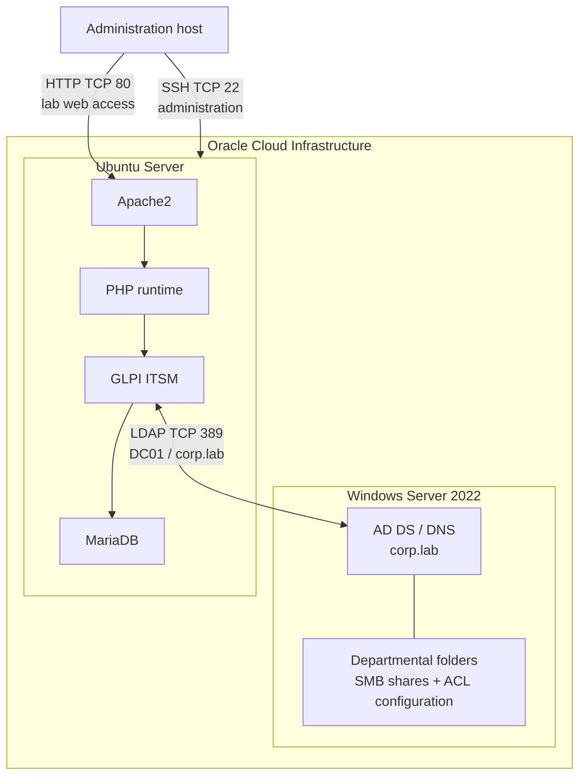

# Architecture and network relationships

## Logical components

The lab uses two virtual machines in Oracle Cloud Infrastructure:

1. **Windows Server 2022 Standard — `DC01`:** Active Directory Domain Services, DNS and departmental file resources for `corp.lab`.
2. **Ubuntu Server — GLPI host:** Apache2, PHP, GLPI and MariaDB.

An administration host was used to access the GLPI web interface and administer Ubuntu over SSH. Some original GLPI screenshots retain a historical server IP in the browser address bar; that address is not a credential and its current availability has not been checked.

## Documented ports

| Port | Purpose | Security considerations |
|---|---|---|
| TCP 22 | SSH administration of Ubuntu | Restrict source ranges and use correctly protected SSH keys. |
| TCP 80 | Browser access to GLPI over HTTP | HTTP is unencrypted; use HTTPS for persistent deployments. |
| TCP 389 | LDAP communication between GLPI and AD DS | Use LDAPS or StartTLS with certificate validation outside an isolated lab. |
| TCP 53 | DNS within the corporate subnet | Restrict DNS access to the systems that need it. |

## Evidence and limitations

One GLPI LDAP test captured during the project shows a successful connection to `dc01.corp.lab:389`, successful Base DN and LDAP URI checks, successful bind authentication and a search that returned 23 entries. This is evidence of that captured test, not current service availability. The selected share screenshots show inventory and one folder ACL view; neither proves effective access. The full positive/negative user access matrix remains incomplete, and the Finance evidence conflicts.

Earlier lab notes reference a WireGuard tunnel named `corp_lab_tunnel`, UDP port `57058`, and tunnel addresses `10.10.0.1` and `10.10.0.2`. Current peer-handshake, route and DNS status are not demonstrated by the screenshots in this repository.
