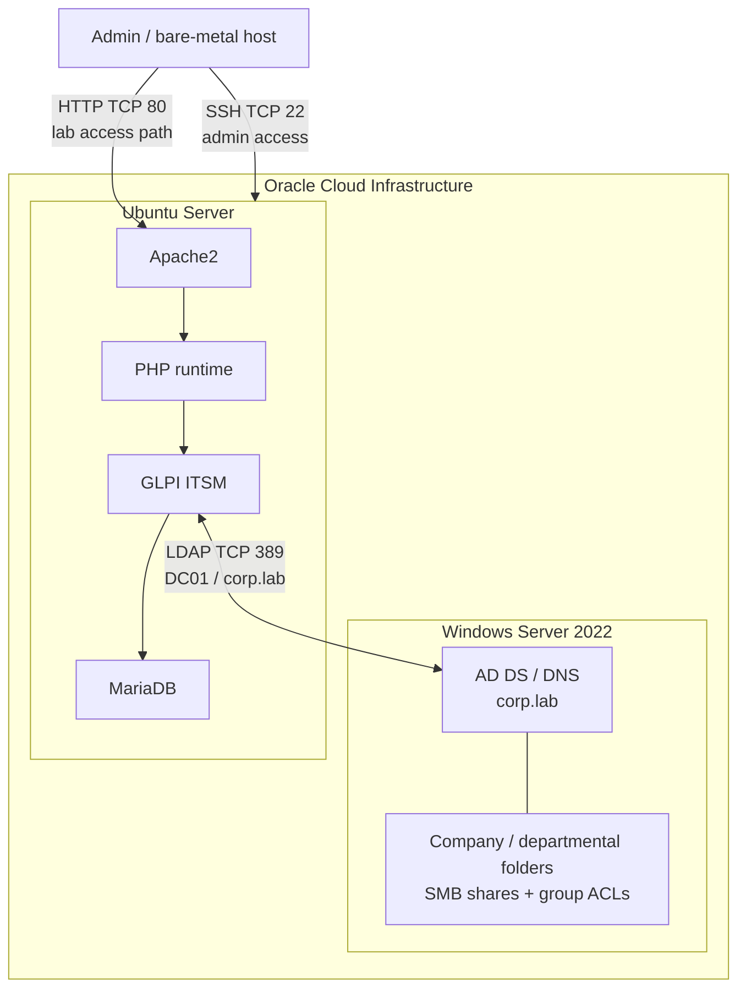

# Architecture and network relationships

## Logical components

The Phase 1 implementation described in the supplied report has two primary cloud virtual machines:

1. **Windows Server 2022 Standard — `DC01`**: Active Directory Domain Services for `corp.lab`, departmental users/groups and departmental file resources.
2. **Ubuntu Server — GLPI host**: Apache2, PHP, GLPI and MariaDB.

The bare-metal host was used to reach the GLPI interface using the Ubuntu instance's public network address. The provided screenshots show that the browser address contained a public IP; this has been redacted from the published evidence.

## Ports recorded in the source report

| Port | Documented purpose | Security note |
|---|---|---|
| TCP 22 | SSH administration of Ubuntu | Restrict source CIDRs; keep private key access at `0600` on Linux clients. |
| TCP 80 | Browser access to GLPI over HTTP | HTTP is not encrypted. Do not expose credential-bearing sessions to untrusted networks; use TLS and access restrictions for any persistent environment. |
| TCP 389 | LDAP communication between GLPI and AD DS | LDAP without TLS is not suitable for untrusted networks. A production-grade implementation should use LDAPS or StartTLS with certificate validation and a least-privilege bind account. |

## What the evidence establishes

The screenshot `screenshots/glpi-ldap-connection-test.jpg` visibly reports successful TCP connection to `dc01.corp.lab` on port 389, successful base-DN configuration, LDAP URI check, bind authentication, and search with 23 entries returned. This is evidence for the captured test at that time, not a guarantee that OCI instances are currently running.

The shared-folder report and screenshots show department resources and group-oriented permission administration. Per-user allowed/denied access was not completely verified; see [the verification review](phase-1-verification-review.md).

## Related connectivity notes

Earlier lab notes also referenced a WireGuard tunnel named `corp_lab_tunnel`, UDP port `57058`, and tunnel addresses `10.10.0.1` / `10.10.0.2`. Those details are not established by the attached Phase 1 implementation report and are therefore treated as related historical notes, not as verified flows in this diagram. Reconfirm routes, peer handshakes and DNS behaviour before describing that path as operational.
